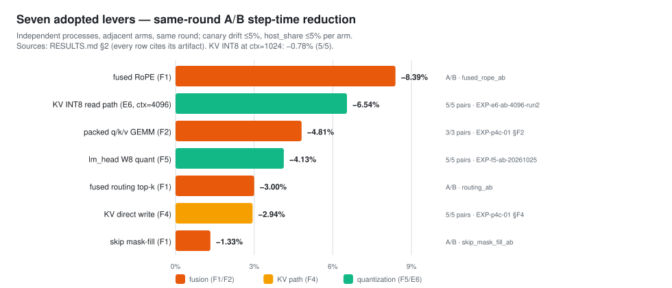
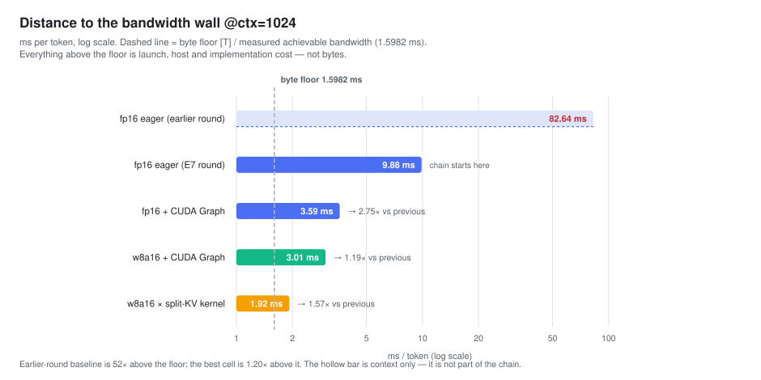
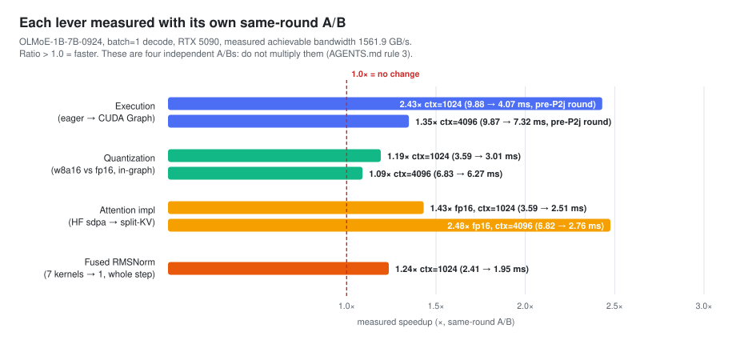
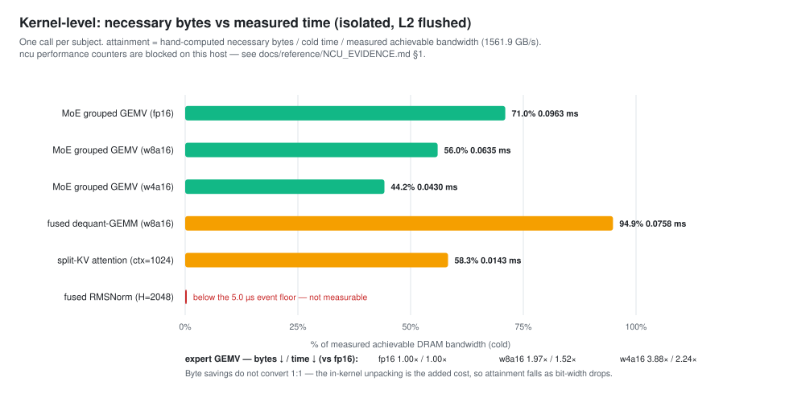

# LeanMoE-Quant


**Byte-budget-driven quantization + Triton kernel optimization for MoE decode at batch=1.**
单张 RTX 5090 上把 OLMoE-1B-7B（64 专家 / top-8）的单请求 decode 从 **82.6 ms/token**
优化到 **1.46 / 1.61 ms**（ctx 1024/4096，685 / 622 tok/s），最好格对原生基线
**2.44× / 4.25×**——并实测出这条路线的**结构性上限**。

> **EN**: six custom Triton kernel families, seven independently A/B-tested levers (all
> adopted), a *measured* structural ceiling (~1.69× at ctx=1024, because weights are only
> ~41% of a decode step), and first-class negative results. Every number on this page
> traces to an artifact; nothing is published without passing its accuracy gate.
>
> **中文**：6 个自研 Triton kernel 族、七条各自独立同轮 A/B 的杠杆（全部采纳）、**实测**的
> 结构性上限（权重只占一步 ~41% ⇒ 完美权重路径也只有 ~1.69×）、一等的负结果。本页每个
> 数字都可追溯到工件；不过正确性门的配置不发布性能数字。

---

## 🏆 Highlights 项目亮点

**1 · 七条杠杆，每条独立同轮 A/B，全部采纳**
CUDA Graph / 权重 W8 / split-KV attention / 融合 RMSNorm / packed q·k·v / KV 直写 /
lm_head W8 / **KV-INT8** —— kernels per step **994 → 345**（见下图）。

**2 · 实测出量化的天花板**
权重流只占一步的 40.9% / 23.5%（从刷新 payload 反推）⇒ 完美权重路径的上限也只有
**~1.69× / ~1.31×**。Marlin 类 kernel 3–4× 的前提（4-bit 过门）在本模型不成立。

**3 · KV-INT8 读路径（自研 kernel）**
per-token 对称 int8 + attention kernel 内 scale 折叠（读路径零解包），精度近无损
（门 KL 0.0006），@4096 **−109 µs/步（−6.5%）**。

**4 · 负结果是一等公民**
4-bit 全系（W4-RTN / GPTQ、MXFP4、混合退路）被精度门挡住，只发布证据不发布延迟；
w8a8@4096 的 5 窗 PASS 经 10 窗复测不稳健被主动 de-publish；融合反量化在 eager 上被
否证（孤立 kernel 快 1.21×、端到端反而慢 5%）。

**5 · 测量纪律**
每轮首尾同格金丝雀（>5% 漂移整轮 VOID）、独立进程同轮相邻 A/B + 逐对胜负 + MAD、
host_share ≤5% 逐格自检、每张门表由测试钉死到工件——733 项 CPU 测试 + CI 四门。

---

## 📊 Metrics 指标数据

### Decode step latency 解码步延迟（ms/token，越低越好）

| 配置 Configuration | ctx=1024 | ctx=4096 | gate |
| --- | ---: | ---: | :---: |
| fp16 × sdpa（原生基线 native baseline） | 3.5660 | 6.8329 | PASS |
| fp16 × split-KV kernel | 2.2028 | 2.3484 | PASS |
| w8a16 × sdpa | 2.9165 | 6.2298 | PASS |
| **w8a16 + lm_head W8 + KV-INT8 × kernel（canonical）** | **1.4602** | **1.6075** | PASS |

> 同轮同格可比（same-round cells only）；最好格 = fp16×sdpa / canonical = **2.44× / 4.25×**。

### 七条杠杆的同轮 A/B 步时降幅 Seven levers — same-round A/B step-time reduction



### 离带宽墙的距离 To the bandwidth wall（82.6 ms 起点 → 1.60 ms 字节下限）



### 各轴加速分解 Per-axis speedups



### Kernel 级带宽达成 Kernel bandwidth attainment（isolated, L2 flushed）



### 精度 Accuracy（门：KL < 0.01 且 top-1 ≥ 0.95）

| 表面 Surface | KL | top-1 | 任务级 Task-level |
| --- | ---: | ---: | --- |
| 权重 w8a16 | 0.0014 | 0.976 | PPL +0.0088%（wikitext-2 全集）· MMLU −0.50 pt |
| lm_head W8 | 0.000061 | 1.000 | （三链同上） |
| KV-INT8 | 0.0006 / 0.0013 | 0.988 / 0.982 | forced 轨迹门（165 位置/ctx） |

完整的一页纸结果（每个数字带工件路径）：**[RESULTS.md](RESULTS.md)**。

---

## Reproduce 如何复现

```bash
# 1) 环境（Mac/CPU 可跑全部非 GPU 测试；性能测量需 NVIDIA GPU + triton）
uv venv -p 3.12 .venv && uv pip install -e ".[dev]"

# 2) 正确性测试（733 项，无需 GPU）
uv run pytest -m "not gpu" -q

# 3) 机器标定：实测可达带宽（roofline 分母，禁用规格值）
uv run python -m tools.probe_machine --json results/machine_probe.json

# 4) 跑一个实验格（示例：canonical 格 w8a16×kernel×cudagraph @1024）
uv run python -m benchmarks.runner \
    --exp EXP-p4c-01-in-graph-attention \
    --model <local OLMoE snapshot> \
    --ctx 1024 --bit-width w8a16 --attn kernel \
    --execution cudagraph --moe grouped --dequant fused --force

# 5) 从工件重生成全部图表（本页 4 张 SVG 即此产物）
uv run python -m tools.make_figures
```

实验矩阵（唯一 cell 来源）在 [configs/experiments.yaml](configs/experiments.yaml)；
上机与环境细节见仓库内 `ENVIRONMENT.md` / `docs/reference/`（部分运维文档仅保留在维护者本地，未入库）。

---

## Repo layout 目录

```text
RESULTS.md                 # ★ 一页纸结果（每个数字带出处）
experiments/<EXP-ID>.md    # ★ 每个实验的权威记录（预注册假设/判据/结果/适用范围）
src/lemoq/kernels/         # 6 个 Triton kernel 族：grouped MoE GEMV、fused dequant GEMM、
                           #   split-KV decode attention、fused RMSNorm、packed q/k/v、KV-INT8
src/lemoq/quant/           # 量化实现（W8/W4 per-group、门引用、逐表面 gate 表）
benchmarks/runner.py       # harness：五条加载前拒绝 + payload schema + correctness 门
tools/                     # probe / operator ledger / figures / quant gate 工具链
tests/                     # 733 项 CPU 测试（parity 门、schema 守卫、门表钉死）
docs/figures/              # 4 figures, regenerated from artifacts 从工件重生成的图表
docs/reference/            # METRICS / MODELS / SPECS / NCU_EVIDENCE（技术参考）
```

> 适用范围 Applicability：所有数字为 **batch=1 单流**、单张 RTX 5090（sm_120）、
> OLMoE-1B-7B-0924、ctx ∈ {1024, 4096} 的测量；结论不跨硬件/模型迁移（每份记录的
> Applicability 节写明边界）。
