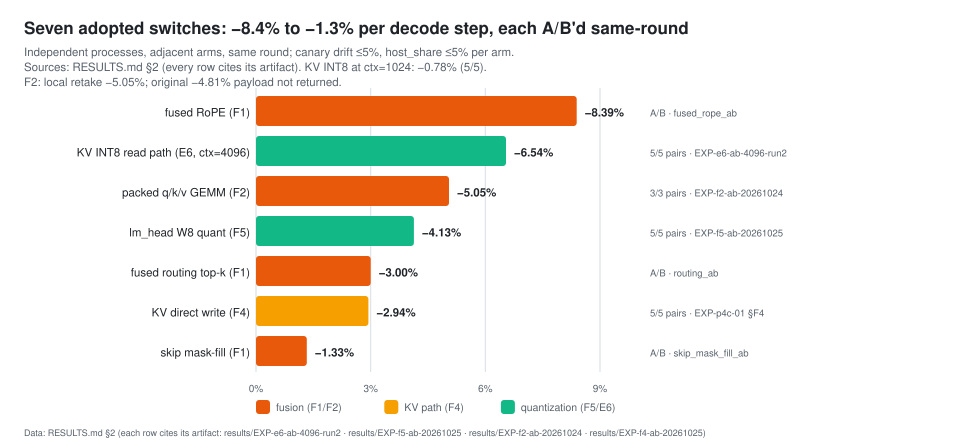
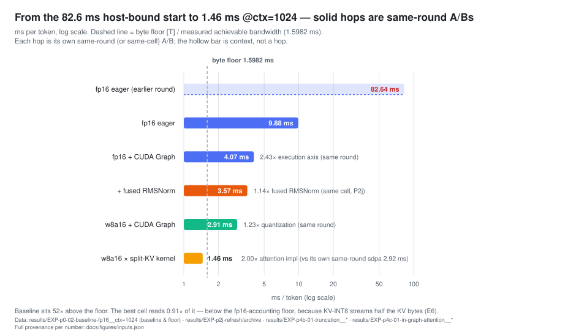
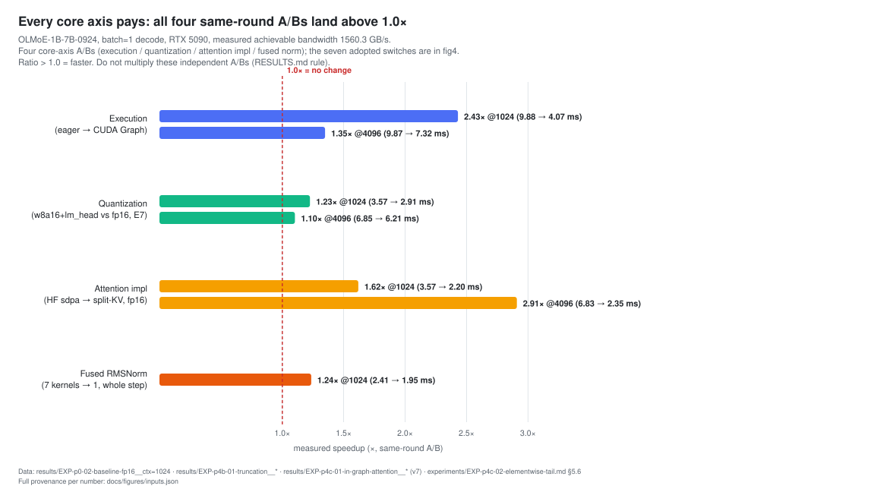
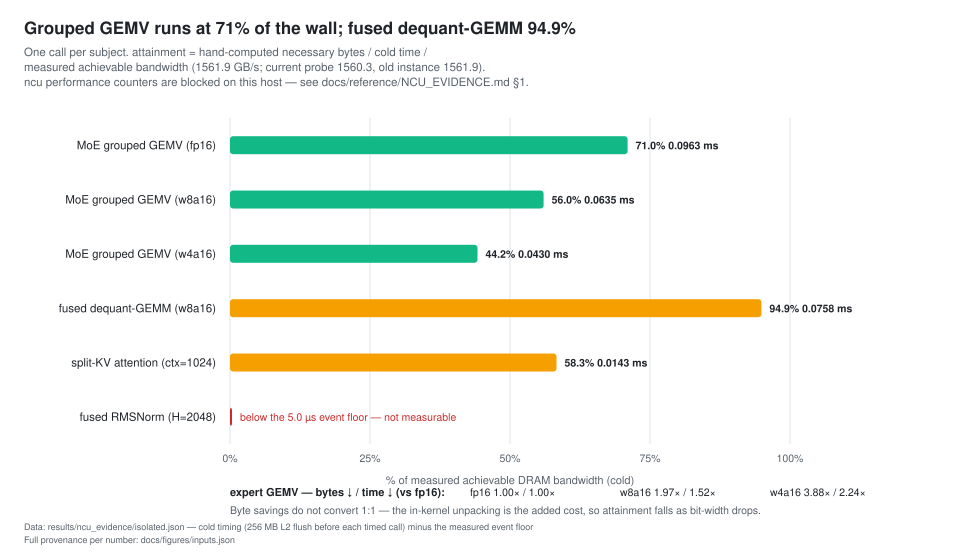

<div align="center">
  
</div>

<p align="center"><a href="README_EN.md">English</a> · <b>简体中文</b></p>

<p align="center">
  
  
  
  
  
  
  
</p>

**Byte-budget-driven quantization + Triton kernel optimization for MoE decode at batch=1.**
实验在单张 RTX 5090 上跑，模型是 OLMoE-1B-7B（64 专家 / top-8），batch=1。decode 的起点是
**82.6 ms/token** 的 eager 实现，瓶颈在 host；canonical 配置做到 **1.46 / 1.61 ms**（ctx 1024/4096，
685 / 622 tok/s）。这两个数是两个端点，不是同一轮的总加速。最好格对原生 fp16×sdpa 基线的
同轮加速是 **2.44× / 4.25×**，口径为稳态 decode 步。权重路径的上限按实测字节地板算是
**~1.74× / ~1.28×**：它假设权重字节归零、其他都不变，不是说上面的 2.44×/4.25× 只能到这个数。
本页数字都能追到工件；没过正确性门的配置不发布延迟。按 32 个输出 token 反算，端到端约
**1.38× / 1.72×**。所有延迟都用全 1 合成 prompt 测，真实文本没测。

---

## 🏆 Highlights 项目亮点

**1 · 七条杠杆，逐条做过同轮 A/B 后采纳**
CUDA Graph / 权重 W8 / split-KV attention / 融合 RMSNorm / KV 直写 / lm_head W8 /
**KV-INT8**，kernels per step 从 **994** 降到 **345**。F1/F2 里的四项融合开关（fused RoPE、
routing、skip mask-fill、packed q·k·v）也一起采纳了，`FUSION_DEFAULTS` 七项都是 True。
F1 这三项只做了同进程交替 **n=2**，统计上 underpowered，采纳看的是方向和 `tokens_equal`；
F2 是独立进程 3/3（RESULTS §2.1）。

**2 · 量化的上限，按实测字节地板算**
权重字节地板只占 fp16×sdpa 步的 **42.4% / 22.1%**，也就是 2.3577 GB / 1560.3 GB/s = 1.511 ms。
就算权重路径一点都不花时间，上界也只有 **~1.74× / ~1.28×**。Marlin 类 kernel 想要的 3–4×，
前提是 4-bit 能过精度门，这个前提在本模型上不成立。旧版的 40.9%/23.5% 是"量化步/fp16 步"
的格比，不是权重份额；1.31 这个数已经撤回。

**3 · KV-INT8 读路径（自研 kernel）**
per-token 对称 int8，scale 折进 attention kernel，读路径不用再解包。门的 KL 是 0.0006，
@4096 每步少 **109 µs（−6.5%）**。

**4 · 负结果也记录**
4-bit 的几条路（W4-RTN / GPTQ、MXFP4、混合退路）都没过精度门，只留证据，不发布延迟。
w8a8@4096 的 5 窗 PASS 在 10 窗复测里不稳健，主动 de-publish 了。融合反量化在 eager 上
被否证：孤立 kernel 快 1.21×，端到端反而慢 5%。

**5 · 测量上的几条规矩**
每轮开头和结尾各跑一次同一格当金丝雀，漂移超过 5% 整轮 VOID；A/B 用独立进程、同轮相邻，
记逐对胜负和 MAD；每格自检 host_share ≤5%；每张门表都由测试钉到工件。CPU 测试 **746** 项，
CI 四门。

---

## 📊 Metrics 指标数据

### Decode step latency 解码步延迟（ms/token，越低越好）

| 配置 Configuration | ctx=1024 | ctx=4096 | gate |
| --- | ---: | ---: | :---: |
| fp16 × sdpa（原生基线 native baseline） | 3.5660 | 6.8329 | PASS |
| fp16 × split-KV kernel | 2.2028 | 2.3484 | PASS |
| w8a16 × sdpa | 2.9165 | 6.2298 | PASS |
| **w8a16 + lm_head W8 + KV-INT8 × kernel（canonical）** | **1.4602** | **1.6075** | PASS |

> 表里只放同轮同格的数。最好格 = fp16×sdpa / canonical = **2.44× / 4.25×**。
> 2.44 有两种等价拆法：`1.2227×1.9968 = 1.6188×1.5086 = 2.4421`；@4096 是
> `1.0968×3.8755 = 2.9096×1.4609 = 4.2506`。`1.5086` 是 kernel 格上的量化比，不是 attention 比。
> 2.44×/4.25× 只算稳态 decode 步，不是端到端请求；32-token E2E 反算约 1.38×/1.72×。

### 七个默认开关的同轮 A/B 步时降幅 Seven adopted switches — same-round A/B step-time reduction



### 离带宽墙的距离 To the bandwidth wall（82.6 ms 起点 → 1.60 ms 字节下限）



### 各轴加速分解 Per-axis speedups



### Kernel 级带宽达成 Kernel bandwidth attainment（isolated, L2 flushed）



### 精度 Accuracy（门：KL < 0.01 且 top-1 ≥ 0.95）

| 表面 Surface | KL | top-1 | 任务级 Task-level |
| --- | ---: | ---: | --- |
| weight-only w8a16 | 0.0014 | 0.976 | PPL **+0.015%**（wikitext-2 全集）· MMLU **−1.0**（n=200，旧测） |
| lm_head W8（隔离） | 0.000061 | 1.000 | PPL **+0.0088%**（wikitext-2 全集） |
| combined w8a16 + lm_head | —（两子门分别引用） | — | PPL **+0.0227%** · MMLU **−0.50**（n=200，当前配置） |
| KV-INT8 | 0.0006 / 0.0013 | 0.988 / 0.982 | forced 轨迹门（165 位置/ctx） |

> 三个精度臂不要混着引用：weight-only、lm_head-only、combined 各有各的出处（RESULTS §3.1）。

带工件路径的一页纸结果在 **[RESULTS.md](RESULTS.md)**。

---

## Reproduce 如何复现

```bash
# 1) 环境（Mac/CPU 可跑全部非 GPU 测试；性能测量需 NVIDIA GPU + triton）
uv venv -p 3.12 .venv && uv pip install -e ".[dev]"

# 2) 正确性测试（746 项，无需 GPU）
uv run pytest -m "not gpu" -q

# 3) 机器标定：实测可达带宽（roofline 分母，禁用规格值）
uv run python -m tools.probe_machine --json results/machine_probe.json

# 4) 跑一个实验格（示例：canonical 格 w8a16×kernel×cudagraph @1024）
uv run python -m benchmarks.runner \
    --exp EXP-p4c-01-in-graph-attention \
    --model <local OLMoE snapshot> \
    --ctx 1024 --bit-width w8a16 --attn kernel \
    --execution cudagraph --moe grouped --dequant fused --force

# 5) 从工件重生成全部图表（本页 4 张 SVG 即此产物，每张图左下角带出处脚注）
uv run python -m tools.make_figures
```

实验矩阵在 [configs/experiments.yaml](configs/experiments.yaml)，cell id 也只从这里来。
上机和环境文档（`ENVIRONMENT.md` 等）留在维护者本地，没有入库；技术参考在
[docs/reference/](docs/reference/)。

---

## Repo layout 目录

```text
RESULTS.md                 # ★ 一页纸结果（每个数字带出处）
experiments/<EXP-ID>.md    # ★ 每个实验的权威记录（预注册假设/判据/结果/适用范围）
src/lemoq/kernels/         # 6 个 Triton kernel 族（4 个 K1 parity 核心 + 2 个集成）：
                           #   grouped MoE GEMV、fused dequant GEMM、split-KV decode attention、
                           #   fused RMSNorm、packed q/k/v、KV-INT8
src/lemoq/quant/           # 量化实现（W8/W4 per-group、门引用、逐表面 gate 表）
benchmarks/runner.py       # harness：五条加载前拒绝 + payload schema + correctness 门
tools/                     # probe / operator ledger / figures / quant gate 工具链
tests/                     # 746 项 CPU 测试（parity 门、schema 守卫、门表钉死）
docs/figures/              # 4 figures, regenerated from artifacts 从工件重生成的图表
docs/reference/            # METRICS / MODELS / SPECS / NCU_EVIDENCE（技术参考）
```

> 适用范围 Applicability：下面这些数字都来自 **batch=1 单流**、单张 RTX 5090（sm_120）、
> OLMoE-1B-7B-0924、ctx ∈ {1024, 4096} 的测量。latency 用全 1 合成 prompt 测，真实文本没测；
> 口径是稳态 decode 步，不是端到端请求。换硬件或换模型都不能直接搬（每份记录的
> Applicability 节写了边界）。
