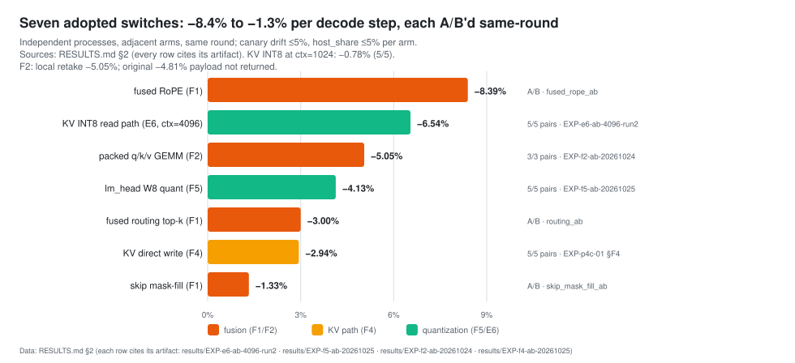
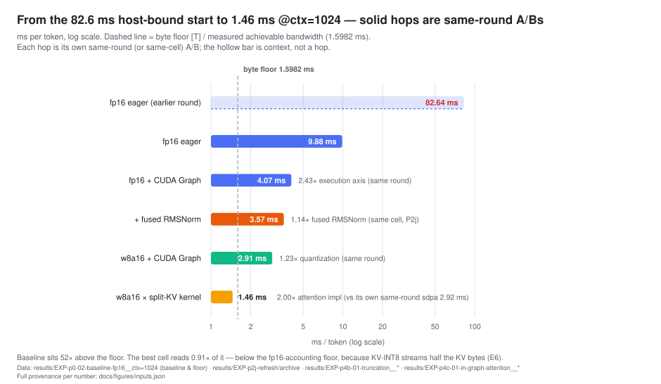
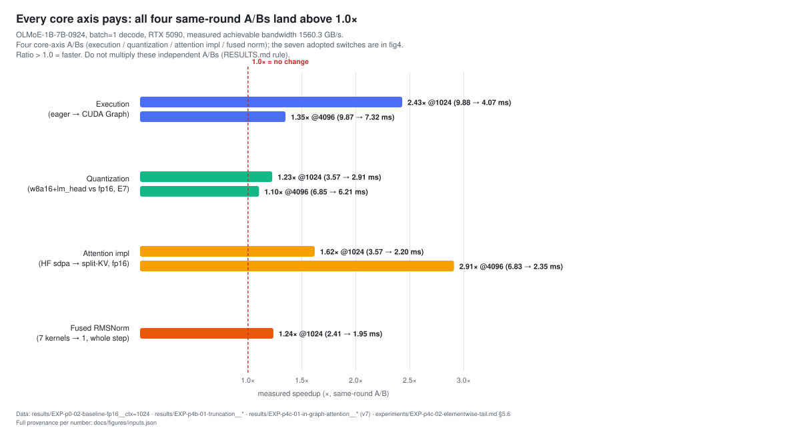
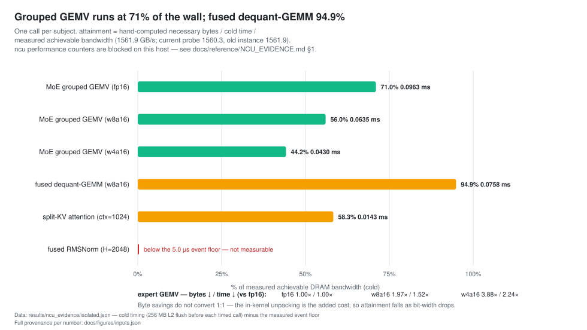

<div align="center">
  
</div>

<p align="center"><b>English</b> · <a href="README.md">简体中文</a></p>

<p align="center">
  
  
  
  
  
  
  
</p>

**Byte-budget-driven quantization + Triton kernel optimization for MoE decode at batch=1.**
On a single RTX 5090, single-request decode of OLMoE-1B-7B (64 experts / top-8) goes from a
**82.6 ms/token** host-bound eager start to **1.46 / 1.61 ms** canonical (ctx 1024/4096,
685 / 622 tok/s; **two endpoints, not a same-round total**); the best cell is **2.44× / 4.25×**
over the native baseline (steady-state decode step). The **weight-path (quantization) ceiling
~1.74× / ~1.28×** is derived from the measured weight-byte floor — it is the bound with weight
bytes at zero and everything else unchanged, **not** a cap on the 2.44×/4.25× end-to-end step.
Every number on this page traces to an artifact;
nothing is published without passing its accuracy gate. 32-token end-to-end (artifact-derived)
is ~**1.38× / 1.72×**; all latency uses a **synthetic all-ones prompt** (real text not measured).

---

## 🏆 Highlights

**1 · Seven levers, each with its own same-round A/B, all adopted**
CUDA Graph / weight W8 / split-KV attention / fused RMSNorm / KV direct write / lm_head W8 /
**KV-INT8** — kernels per step **994 → 345**. The F1/F2 fusion switches (fused RoPE, routing,
skip mask-fill, packed q·k·v) are adopted too; all seven `FUSION_DEFAULTS` are True.
The three F1 switches are same-process **n=2** (statistically underpowered; adopted on direction +
`tokens_equal`); F2 is independent-process 3/3 (RESULTS §2.1).

**2 · The quantization ceiling, derived from the measured byte floor**
The weight-byte floor is only **42.4% / 22.1%** of the fp16×sdpa step
(2.3577 GB / 1560.3 GB/s = 1.511 ms) ⇒ even a perfect weight path caps at **~1.74× / ~1.28×**.
The old 40.9%/23.5% were quantized-step/fp16-step cell ratios, not weight shares; 1.31 is withdrawn.
The premise of Marlin-class 3–4× kernels (4-bit passing the gate) does not hold for this model.

**3 · KV-INT8 read path (custom kernel)**
Per-token symmetric int8 with scale folding inside the attention kernel (zero unpacking on the
read path); near-lossless (gate KL 0.0006), **−109 µs/step (−6.5%)** @4096.

**4 · Negative results are first-class citizens**
All 4-bit variants (W4-RTN / GPTQ, MXFP4, mixed-bit fallback) were stopped by the accuracy
gate — evidence published, latency never; w8a8@4096's 5-window PASS was actively de-published
after a 10-window re-measurement showed it not robust; dequant fusion was refuted on the eager
path (the isolated kernel is 1.21× cheaper, end-to-end 5% slower).

**5 · Measurement discipline**
Same-cell canary first and last in every round (>5% drift VOIDs the round), independent-process
adjacent A/B with per-pair wins + MAD, host_share ≤5% per-cell self-check, every gate table
pinned to its artifacts by tests — 746 CPU tests + four CI gates.

---

## 📊 Metrics

### Decode step latency (ms/token, lower is better)

| Configuration | ctx=1024 | ctx=4096 | gate |
| --- | ---: | ---: | :---: |
| fp16 × sdpa (native baseline) | 3.5660 | 6.8329 | PASS |
| fp16 × split-KV kernel | 2.2028 | 2.3484 | PASS |
| w8a16 × sdpa | 2.9165 | 6.2298 | PASS |
| **w8a16 + lm_head W8 + KV-INT8 × kernel (canonical)** | **1.4602** | **1.6075** | PASS |

> Same-round cells only; best cell = fp16×sdpa / canonical = **2.44× / 4.25×**.
> Two equivalent factorizations: `1.2227×1.9968 = 1.6188×1.5086 = 2.4421`
> (@4096 `1.0968×3.8755 = 2.9096×1.4609 = 4.2506`). `1.5086` is the **quantization ratio on the
> kernel cell, not the attention ratio**. 2.44×/4.25× is a steady-state decode-step ratio, not an
> end-to-end request; the artifact-derived 32-token E2E is ~1.38×/1.72×.

### Seven adopted switches — same-round A/B step-time reduction



### To the bandwidth wall (82.6 ms start → 1.60 ms byte floor)



### Per-axis speedups



### Kernel bandwidth attainment (isolated, L2 flushed)



### Accuracy (gate: KL < 0.01 and top-1 ≥ 0.95)

| Surface | KL | top-1 | Task-level |
| --- | ---: | ---: | --- |
| weight-only w8a16 | 0.0014 | 0.976 | PPL **+0.015%** (wikitext-2 full) · MMLU **−1.0** (n=200, earlier run) |
| lm_head W8 (isolated) | 0.000061 | 1.000 | PPL **+0.0088%** (wikitext-2 full) |
| combined w8a16 + lm_head | — (two sub-gates) | — | PPL **+0.0227%** · MMLU **−0.50** (n=200, current config) |
| KV-INT8 | 0.0006 / 0.0013 | 0.988 / 0.982 | forced-trajectory gate (165 positions/ctx) |

> Do not mix the three accuracy surfaces: weight-only, lm_head-only and combined each have their
> own artifact (RESULTS §3.1).

The one-page result (every number with its artifact path): **[RESULTS.md](RESULTS.md)**.

---

## Reproduce

```bash
# 1) Environment (all non-GPU tests run on Mac/CPU; latency measurement needs an NVIDIA GPU + triton)
uv venv -p 3.12 .venv && uv pip install -e ".[dev]"

# 2) Correctness tests (746, no GPU needed)
uv run pytest -m "not gpu" -q

# 3) Machine calibration: measured achievable bandwidth (the roofline denominator; spec values are banned)
uv run python -m tools.probe_machine --json results/machine_probe.json

# 4) Run one experiment cell (example: the canonical cell w8a16×kernel×cudagraph @1024)
uv run python -m benchmarks.runner \
    --exp EXP-p4c-01-in-graph-attention \
    --model <local OLMoE snapshot> \
    --ctx 1024 --bit-width w8a16 --attn kernel \
    --execution cudagraph --moe grouped --dequant fused --force

# 5) Regenerate all figures from artifacts (the 4 SVGs on this page are exactly this output,
#    each with a per-figure source footnote)
uv run python -m tools.make_figures
```

The experiment matrix (the only source of cells) is [configs/experiments.yaml](configs/experiments.yaml);
ops docs (`ENVIRONMENT.md` etc.) are kept maintainer-local and not in the repo; technical
references live in [docs/reference/](docs/reference/).

---

## Repo layout

```text
RESULTS.md                 # ★ the one-page result (every number cites its source)
experiments/<EXP-ID>.md    # ★ the authoritative record per experiment (pre-registered
                           #   hypothesis/criteria/results/applicability)
src/lemoq/kernels/         # 6 Triton kernel families: grouped MoE GEMV, fused dequant GEMM,
                           #   split-KV decode attention, fused RMSNorm, packed q/k/v, KV-INT8
src/lemoq/quant/           # quantization (W8/W4 per-group, gate citations, per-surface gate tables)
benchmarks/runner.py       # harness: five load-time refusals + payload schema + correctness gate
tools/                     # probe / operator ledger / figures / quant gate toolchain
tests/                     # 746 CPU tests (parity gate, schema guards, pinned gate tables)
docs/figures/              # 4 figures, regenerated from artifacts
docs/reference/            # METRICS / MODELS / SPECS / NCU_EVIDENCE (technical reference)
```

> Applicability: every number is a **batch=1 single-stream** measurement on one RTX 5090
> (sm_120), OLMoE-1B-7B-0924, ctx ∈ {1024, 4096}; latency uses a **synthetic all-ones prompt**
> (real text not measured) and is a **steady-state decode step**, not an end-to-end request.
> Conclusions do not transfer across hardware/models (each record's Applicability section
> states the boundary).
